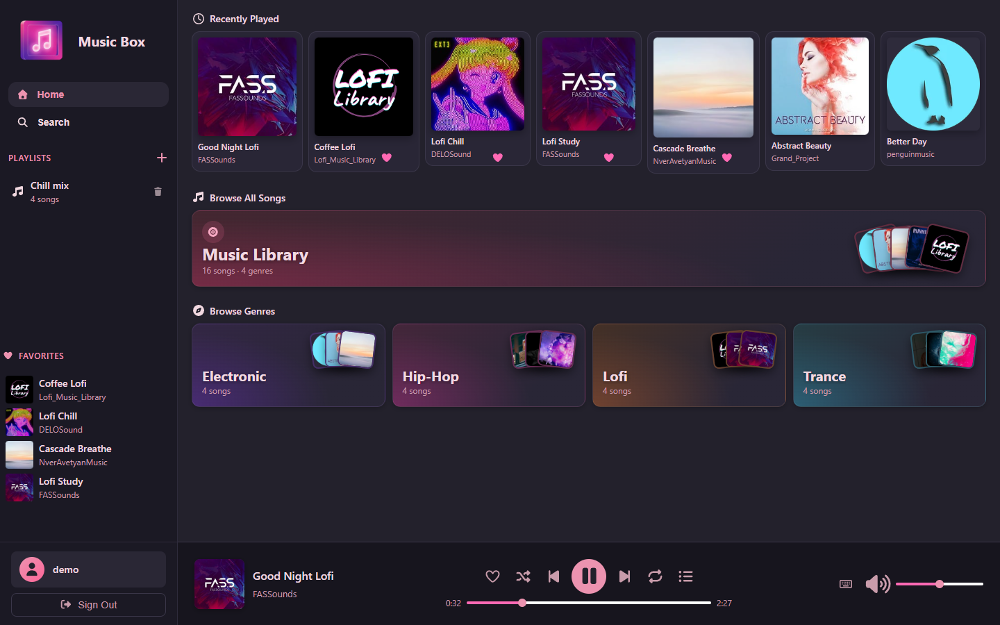
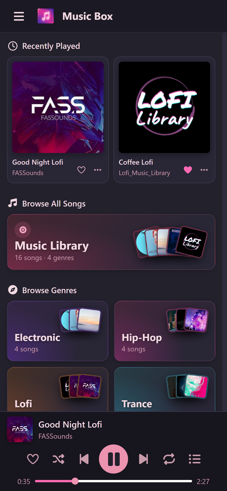
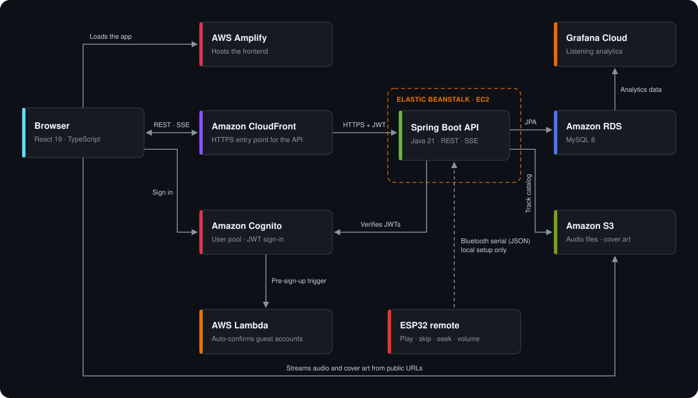

<p align="center">
  
</p>
<h1 align="center">Music Box</h1>
<p align="center">
  <strong>A cloud-based music streaming service with a physical Bluetooth remote for playback and volume control.</strong>
</p>
<p align="center">
  <a href="https://musicbox.website"><strong>Try it live → musicbox.website</strong></a>
</p>
<p align="center">
  
  
  
  
  
  
  
</p>

## Contents
- [Overview](#overview)
- [Preview](#preview)
- [Highlights](#highlights)
- [Features](#features)
- [Architecture](#architecture)
- [ESP32 Bluetooth Remote](#esp32-bluetooth-remote)
- [Database Schema](#database-schema)
- [Security](#security)
- [Monitoring](#monitoring)
- [Running Locally](#running-locally)
- [Music Credits](#music-credits)
- [License](#license)

## Overview
Music Box streams music from the cloud to the browser and lets you control playback from a
handheld ESP32 remote. No account is needed: every visitor gets their own guest session and can
start listening right away. Creating an account (username or email) keeps your playlists and
favorites, and your guest data moves over when you sign up.

## Preview
<table>
  <tr>
    <th>Desktop</th>
    <th>Mobile</th>
  </tr>
  <tr>
    <td valign="top"></td>
    <td valign="top" width="25%"></td>
  </tr>
</table>

## Highlights
- **Live updates with Server-Sent Events.** Player state and playlist changes are pushed from the
  API to every open tab and device, with no polling.
- **Guest sessions without sign-up friction.** A Cognito pre-sign-up Lambda confirms throwaway
  guest accounts, and an API endpoint moves a guest's playlists and favorites to their new account.
- **A player per user.** Each user has their own queue, track and volume, kept in sync across
  their signed-in devices.
- **Tuned for small instances.** Turning off Spring's open-in-view stopped long-lived audio streams
  from each holding a database connection, which had exhausted the connection pool at about
  ten concurrent listeners.
- **Hardware control.** An ESP32 remote sends play, pause, skip, seek and volume commands to the
  backend over Bluetooth serial.

## Features
- Optional accounts: a guest session per visitor, or sign in with username or email
- Playlists you can create, rename and trim, plus favorites and recently played
- Pages with their own URLs and link previews
- Media keys, keyboard shortcuts and a menu on every song
- Responsive layout for desktop, tablet and phone
- Listening analytics in Grafana
- ESP32 Bluetooth remote

## Architecture
A single Spring Boot API serves the React frontend, backed by managed AWS services:



| Layer | Technology |
|---|---|
| Frontend | React 19 and TypeScript, hosted on AWS Amplify |
| API | Spring Boot 3.5 (Java 21) on Elastic Beanstalk, behind CloudFront |
| Database | MySQL 8 on Amazon RDS, accessed through Spring Data JPA |
| Media storage | Amazon S3 for audio files and cover art |
| Authentication | Amazon Cognito (JWT), with a Lambda trigger for guest accounts |
| Live updates | Server-Sent Events |
| Analytics | Grafana Cloud |
| Hardware | ESP32 microcontroller over Bluetooth serial |

## ESP32 Bluetooth Remote
A handheld controller for playback and volume:


- Play and pause
- Next and previous track
- Volume with a rotary encoder, plus mute
- Seek forward 10 seconds
- Sends JSON commands over Bluetooth serial to the backend running on the paired computer

## Database Schema


- **Users:** managed by Amazon Cognito and referenced by their Cognito ID
- **Songs:** metadata in MySQL, audio and covers in S3
- **Playlists:** user-created, with a many-to-many link to songs
- **Favorites:** each user's liked songs
- **Command log and volume log:** playback and volume history for analytics

## Security
- Every API request apart from health checks needs a Cognito JWT, verified by Spring Security
- Frontend and API are served over HTTPS (Amplify and CloudFront)

## Monitoring
A Grafana dashboard shows the top 5 songs, the latest commands, command distribution and song count.


## Running Locally
**Prerequisites:** Java 21, Node.js 20+, Docker, and your own Amazon Cognito user pool and S3 bucket.

```bash
git clone https://github.com/Keffii/music_box.git
cd music_box

# 1. Start MySQL (listens on localhost:3307)
docker compose up -d db
```

```bash
# 2. Start the API on http://localhost:8080 (new terminal, from the repo root)
cd backend
export SPRING_DATASOURCE_URL="jdbc:mysql://localhost:3307/wireless_music_player_db"
export SPRING_DATASOURCE_USERNAME=admin
export SPRING_DATASOURCE_PASSWORD=password
export AWS_S3_BUCKET=your-bucket
export AWS_COGNITO_USER_POOL_ID=your-user-pool-id
export AWS_COGNITO_APP_CLIENT_ID=your-app-client-id
export SERIAL_ENABLED=false   # true only with the ESP32 paired to this computer
./mvnw spring-boot:run
```

```bash
# 3. Start the frontend on http://localhost:8001 (new terminal, from the repo root)
cd frontend
cp .env.example .env          # then fill in your Cognito IDs
npm install
npm start
```

## Music Credits
All music is royalty-free from Pixabay.

| Genre | Tracks |
|---|---|
| Electronic | [Better Day](https://pixabay.com/music/beats-better-day-186374/), [Abstract Beauty](https://pixabay.com/music/upbeat-abstract-beauty-378257/), [Cascade Breathe](https://pixabay.com/music/beats-cascade-breathe-future-garage-412839/), [Running Night](https://pixabay.com/music/funk-running-night-393139/) |
| Lofi | [Coffee Lofi](https://pixabay.com/music/lofi-coffee-lofi-lofi-music-chill-ambient-458900/), [Good Night Lofi](https://pixabay.com/music/beats-good-night-lofi-cozy-chill-music-160166/), [Lofi Study](https://pixabay.com/music/beats-lofi-study-calm-peaceful-chill-hop-112191/), [Lofi Chill](https://pixabay.com/music/lofi-lofi-lofi-chill-lofi-girl-456265/) |
| Hip-Hop | [Hype Drill Music](https://pixabay.com/music/trap-hype-drill-music-438398/), [Lonewolf Dark Trap](https://pixabay.com/music/trap-lonewolf-dark-hard-sad-trap-beat-prod-by-onesevenbeatxs-156895/), [Hip Hop Beat](https://pixabay.com/music/beats-hiphop-427992/), [Energetic Hip Hop](https://pixabay.com/music/beats-energetic-hip-hop-8303/) |
| Trance | [Trance Dance Club](https://pixabay.com/music/upbeat-trance-dance-club-music-409571/), [Trance](https://pixabay.com/music/techno-trance-trance-123192/), [Smart Factory](https://pixabay.com/music/dance-trance-137032/), [Pure Trance](https://pixabay.com/music/electro-pure-trance-459528/) |

## License
[MIT](LICENSE)
